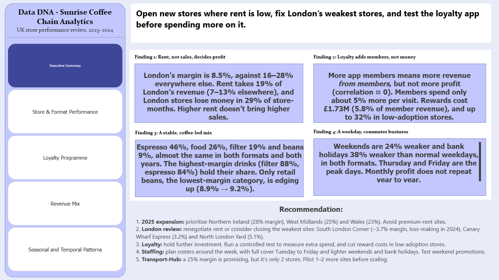
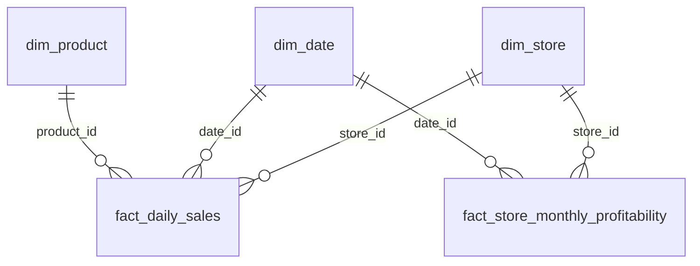

# ☕ Sunrise Coffee Chain: Store Performance & Loyalty Analysis

**DataDNA Dataset Challenge, October 2026**
An end-to-end analysis of a 60-store UK coffee chain (2023–2024): data audit in Python, analysis in SQL, and a 5-page interactive Power BI dashboard.



---

## 📌 The business question

Sunrise Coffee's Chief Commercial Officer asked for a performance review ahead of the 2025 expansion plan:

1. **Which store formats and regions** really drive the business, and which should be reviewed?
2. **Is the loyalty programme** generating extra spend, or just costing money?
3. **How is the revenue mix** (espresso, filter, food, retail beans) changing?
4. **How do weekdays, weekends, bank holidays and seasons** affect trading?

---

## 🎯 Headline recommendation

> **Open new stores where rent is low, fix London’s weakest stores, and test the loyalty app before spending more on it.**

### Key findings

| # | Finding | Evidence |
|---|---|---|
| 1 | **Rent, not sales, decides profit** | London's margin is **8.5%**, against **16–28%** in every other region. Rent takes **19%** of London's revenue (7–13% elsewhere), and London stores lose money in **29%** of store-months. Higher rent does not bring higher sales. |
| 2 | **Loyalty adds members, not money** | App adoption tracks member revenue almost perfectly (r = 0.998) but has **no link to profit** (r ≈ 0). Members spend only **~5% more** per visit. Rewards cost **£1.73M**, and up to **32%** of member revenue in low-adoption stores. |
| 3 | **A stable, coffee-led mix** | Espresso 46%, food 26%, filter 19%, beans 9%, almost identical across formats and years. The highest-margin drinks (filter 88%, espresso 84%) hold their share. Only retail beans, the lowest-margin category, is edging up (8.9% → 9.2%). |
| 4 | **A weekday, commuter business** | Weekends are **24% weaker** and bank holidays **38% weaker** than normal weekdays. Thursday and Friday are the peak days. Monthly profit does **not** repeat year to year. |

**Overall:** £89.7M revenue, £16.9M net profit and an 18.8% net margin across 2023–24. The business is flat year on year (profit −0.8%). 31 stores improved and 29 declined.

### Recommendations

1. **2025 expansion:** prioritise Northern Ireland (28% margin), West Midlands (25%) and Wales (23%). Avoid premium-rent sites.
2. **London review:** renegotiate rent or consider closing the weakest sites: South London Corner (−3.7% margin, loss-making in 2024), Canary Wharf Express (3.2%) and North London Yard (5.1%).
3. **Loyalty:** hold further investment. Run a controlled test to measure extra spend, and cut reward costs in low-adoption stores.
4. **Staffing:** plan rosters around the week, with full cover Tuesday to Friday and lighter weekends and bank holidays. Test weekend promotions.
5. **Transport-Hub:** the 25% margin is promising but based on only 2 stores. Pilot 1–2 more sites before scaling.

---

## 📊 Dashboard

The Power BI report has 5 pages. Every chart title states the finding, and each page answers one area of the brief.

| Page | What it answers |
|---|---|
| **Executive Summary** | Headline recommendation, key findings and actions |
| **Store & Format Performance** | Margin by format, loss-making regions, rent vs revenue, 2023 → 2024 store changes |
| **Loyalty Programme** | Adoption vs member revenue and profit, spend per visit, reward cost per store |
| **Revenue Mix** | Mix by format, category margins, food and retail-bean trends |
| **Seasonal & Temporal Patterns** | Day of week, weekday vs weekend, bank holidays, monthly and quarterly patterns |

<details>
<summary>📷 Click to see all dashboard pages</summary>


</details>

---

## 🗂️ Data

The data is a synthetic dataset from the DataDNA challenge, covering **2023–2024**, in GBP. It has 5 tables in a star schema:

| Table | Rows | Grain |
|---|---:|---|
| `dim_store` | 60 | One row per store (format, region, rent, staffing, loyalty adoption) |
| `dim_product` | 40 | One row per catalogue product (category, price, cost, margin) |
| `dim_date` | 730 | One row per day (weekday, weekend and bank-holiday flags) |
| `fact_store_monthly_profitability` | 1,440 | One row per store per month (full P&L, loyalty spend) |
| `fact_daily_sales` | 10,000 | Daily trading records (revenue mix, transactions, footfall) |



Full column definitions are in [`docs/DATA_DICTIONARY.md`](docs/DATA_DICTIONARY.md).

---

## 🔍 Approach

1. **Data audit (Python):** [`scripts/initial_data_audit.py`](scripts/initial_data_audit.py) profiles every table and checks keys, joins, duplicates and calculated fields. Results are in [`outputs/initial_audit/`](outputs/initial_audit/) and summarised in [`docs/INITIAL_DATA_REVIEW.md`](docs/INITIAL_DATA_REVIEW.md).
2. **Analysis (SQL):** the CSVs are loaded into SQLite ([`1_SQL/sql_connection.ipynb`](1_SQL/sql_connection.ipynb)), and each of the 14 guiding questions is answered with SQL in [`1_SQL/analysis.ipynb`](1_SQL/analysis.ipynb).
3. **Exploration (Python):** [`2_Python/data_quality.ipynb`](2_Python/data_quality.ipynb) joins facts to dimensions and explores quality issues.
4. **Dashboard (Power BI):**
   - **Model:** a star schema with 5 one-to-many relationships and a marked date table.
   - **Calculations:** around 45 DAX measures, so ratios like margin % are calculated as *total profit ÷ total revenue* instead of averaging percentages.
   - **Storytelling:** insight-led titles, caveats in subtitles, and an Executive Summary page.

---

## ⚠️ Data limitations

Good analysis states its limits. These shaped how the results were calculated and presented:

- **Only 2 Transport-Hub stores and no Retail-Park stores**, even though the brief mentions three formats. Format comparisons are early signals.
- **Daily sales cover only ~20% of store-days**, and some store-days appear more than once. Daily results therefore use **averages and shares**, never totals.
- **600 of the 1,440 `profitability_status` labels** didn't match the margin rules in the brief, so status was **recalculated from actual net margin**.
- **Monthly rent and staffing** in the fact table differ from the reference values in `dim_store`. The monthly (fact) values were used for P&L.
- **The data can't show whether loyalty spend is truly extra.** Members might have spent the same anyway, which is why the recommendation is to test before investing.

---

## 📁 Repository structure

```
├── 1_SQL/
│   ├── sql_connection.ipynb      # loads CSVs into SQLite (creates analytics.db)
│   └── analysis.ipynb            # SQL answers to the 14 guiding questions
├── 2_Python/
│   └── data_quality.ipynb        # joins and data-quality exploration
├── 3_PowerBI/
│   ├── dashboard.pbix            # Power BI report (5 pages)
│   └── screenshots/              # PNG export of each page
├── data/                         # source CSVs (5 tables)
├── docs/
│   ├── DATA_DICTIONARY.md
│   └── INITIAL_DATA_REVIEW.md
├── outputs/initial_audit/        # audit results (profiles, checks, baselines)
├── scripts/
│   └── initial_data_audit.py     # reproducible data audit
├── CHALLENGE_BRIEF.md            # original challenge brief
└── pyproject.toml                # Python dependencies (uv)
```

---

## ▶️ How to reproduce

**Requirements:** Python 3.11+ and [Power BI Desktop](https://www.microsoft.com/power-bi/desktop) (Windows).

```bash
# 1. Clone and install dependencies
git clone https://github.com/<your-username>/<repo-name>.git
cd <repo-name>
uv sync            # or: pip install pandas ipykernel

# 2. Run the data audit
python scripts/initial_data_audit.py

# 3. Build the SQLite database, then run the SQL analysis
#    Open 1_SQL/sql_connection.ipynb and run all cells (creates 1_SQL/analytics.db)
#    Then open 1_SQL/analysis.ipynb and run all cells
```

**Dashboard:** open `3_PowerBI/dashboard.pbix` in Power BI Desktop. If it asks for the data location, point it to the `data/` folder through **Transform data → Data source settings → Change source**.

---

## 🛠️ Tools

**Python** (pandas, sqlite3) · **SQL** (SQLite) · **Power BI** (Power Query, DAX, data modelling) · **Jupyter** · **Git**

