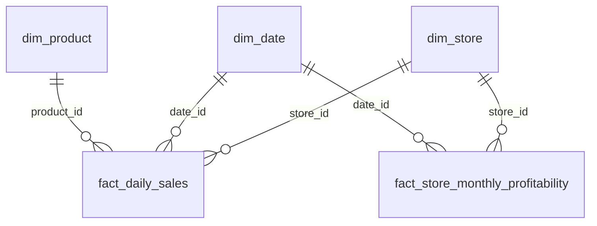

# Initial data review — Sunrise Coffee Chain

Completed 9 October 2026. All five source CSVs were profiled; the source files were preserved.
Reproduce with `.venv\Scripts\python.exe scripts/initial_data_audit.py` from the project root.
Generated evidence and enriched datasets are in `outputs/initial_audit/`.

## Inventory and coverage

| Table | Rows | Columns | Actual interpretation |
|---|---:|---:|---|
| dim_store | 60 | 13 | One store; 12 regions; 58 High-Street and 2 Transport-Hub |
| dim_product | 40 | 9 | One catalogue product; six categories |
| dim_date | 730 | 12 | One date, 2023-01-01 through 2024-12-30 |
| fact_daily_sales | 10,000 | 19 | Daily trading records; store-date grain is not unique |
| fact_store_monthly_profitability | 1,440 | 21 | One store-month; complete 60-store, 24-month grid |

Store statuses: 57 Active, 2 Temporarily-Closed, 1 Refurbishing. Status is a store attribute without effective dates, so it cannot determine historical operating days. No Retail-Park stores are present.

The only observed missing values are 36 product `launch_date` values (90%). No seating, monthly loyalty-share, or monthly footfall values are missing, despite documented examples of missingness. Do not impute unknown launch dates.

## Relationships and model

All five primary keys are unique and non-null. All five foreign-key relationships have zero unmatched rows. Dimension joins were executed with many-to-one validation and preserve the fact row counts.

- Daily `product_id` means the recorded top product. It does not allocate the record's revenue to that product. Product-category revenue and profit cannot be inferred by summing whole records against this key.
- Monthly `date_id` points to the first day of the correct month; `month_id` agrees with it in all 1,440 records.
- `dim_date` lacks the documented `month_id`. The audit derives it from `full_date` in memory and in the daily enriched output.
- Keep the facts separate. For comparison, aggregate daily observations to store-month before joining to monthly data; never join the raw facts on store alone.
- Use monthly fact rent and staffing values for historical P&L. Enriched outputs retain store attributes with `_store` suffixes where names overlap.

## Quality findings and handling

| Finding | Evidence | Handling |
|---|---|---|
| Repeated daily grain | 8,910 distinct store-days; 1,090 excess records; even store-date-product has 34 excess records | Preserve and flag; investigate meaning before daily totals. No exact duplicate source rows or duplicate daily IDs were found, so automatic deduplication is unjustified. |
| Partial daily coverage | Distinct store-days represent 20.31% of 60 × 731 possible calendar days | Treat as observed records, not a complete estate ledger. This denominator is calendar capacity, not verified operating days. Inspect coverage by store and month. |
| Missing calendar date | 2024-12-31 absent | Flag; do not fabricate missing transactions. Add a calendar date only if needed for a complete reporting calendar. |
| Cost attributes disagree | All 1,440 monthly rent values and all 1,440 staffing values differ from store values | Use the fact costs; static store values may be reference figures. This contradicts the documented equality, but does not by itself establish an error. |
| Profitability labels disagree | 600 of 1,440 labels (41.67%) disagree with documented margin bands | Retain original status and add calculated status. Use actual profit/margin for decisions; resolve band definitions before publishing classification results. |
| Catalogue launch dates missing | 36 of 40 | Exclude launch-cohort analysis unless dates become available. |

Calculated bands use lower-inclusive thresholds: below −15% Structural-Loss; −15% to below −2% Loss-Making; −2% to below 8% Break-Even; 8% to below 20% Profitable; 20% and above Highly-Profitable. The brief's wording is ambiguous at exact endpoints; this convention is explicit. The source label ranges overlap substantially, so discrepancies are not simply endpoint ambiguity.

Passed checks include category revenues summing to daily revenue, daily average transaction value, monthly profit calculation, member/non-member revenue reconciliation, monthly margin and member share, catalogue margins, loyalty transaction limits, footfall limits, and date-derived calendar attributes. Currency equations allow £0.02 rounding tolerance; ratios allow 0.001. No negative numeric inputs outside profit/margin were found. No records precede store opening year. Opening month is unavailable.

The bank-holiday flags were profiled but were not externally verified. Their documentation specifies England and Wales; Scotland and Northern Ireland require regional calendars for regional holiday conclusions. Geographic mappings, actual store operating histories, and daily gross-profit accounting cannot be independently verified from these files alone.

## Initial baseline and statistical relationships

| Year | Revenue | Net profit | Aggregate net margin |
|---|---:|---:|---:|
| 2023 | £44,982,189.94 | £8,473,165.55 | 18.84% |
| 2024 | £44,703,799.24 | £8,406,338.52 | 18.80% |

Margins above are total profit divided by total revenue, rather than averages of monthly percentages. This baseline does not establish which stores drive the change.

Exploratory Pearson correlations across 60 stores, using two-year totals and one adoption observation per store:

- Loyalty adoption vs member revenue share: **0.998**.
- Loyalty adoption vs aggregate net margin: **−0.014**.
- Store reference rent vs aggregate net margin: **−0.418**.
- Store reference rent vs total revenue: **0.153**.

These are associations without controls or causal interpretation. The near-perfect adoption/member-share relationship deserves scrutiny for possible construction or mechanical dependence. It does not demonstrate incremental loyalty revenue. Rent is already part of the profit formula, which partly explains its relationship to margin.

## Prepared artifacts

- `column_profile.csv`: types, missingness, distinct values, numeric ranges for every field.
- `quality_checks.csv` and `relationships.csv`: validation results and join checks.
- Per-table summary and categorical-count CSVs: distributions and descriptive statistics.
- `daily_store-date_repeated_rows.csv`: all records belonging to repeated daily store-date groups.
- `profitability_status_discrepancies.csv` and `source_status_margin_ranges.csv`: status evidence.
- `daily_monthly_coverage.csv`: observed days, rows, revenue, and monthly comparison for each store-month. Revenue differences are diagnostic; incomplete daily coverage prevents direct reconciliation expectations.
- `monthly_enriched.csv`: store context, calendar context, original and calculated profitability status.
- `daily_enriched.csv`: store/calendar context and derived month key; repeats preserved.
- `store_baseline.csv`, `baseline_by_year.csv`, `baseline_by_region.csv`, `baseline_by_store_format.csv`: initial financial summaries.
- `store_correlations.csv` and `audit_summary.json`: exploratory relationships and machine-readable overview.

## Next analytical steps

1. Begin profitability and year-on-year comparisons using the complete monthly fact and weighted margins. Separate persistent losses from occasional weak months.
2. Compare regions and individual stores; state the 58-versus-2 format imbalance and lack of Retail-Park observations.
3. Resolve the daily record grain before publishing daily totals, mix changes, or holiday effects. Coverage and sampling can bias even per-record averages.
4. Evaluate loyalty participation and reward cost descriptively. Member revenue minus redemption cost is not incremental profit or programme ROI; member/non-member transaction counts and a credible counterfactual are unavailable.
5. Analyse the four explicit revenue streams after the daily-grain review. The product catalogue also includes Cold-Drinks and Merchandise, which have no separate daily revenue fields; their treatment cannot be established from the dictionary.
6. Assemble charts and recommendations only after documenting these limitations. Store closures and loyalty investment require stronger evidence than labels and raw correlations.
